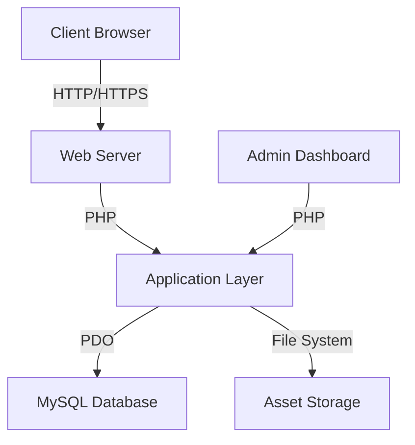

# System Architecture

## Overview

BookHaven is designed using a modular architecture that separates concerns between frontend, backend, and database layers. This document outlines the system's architecture, components, and their interactions.

## Architecture Diagram

## Components

