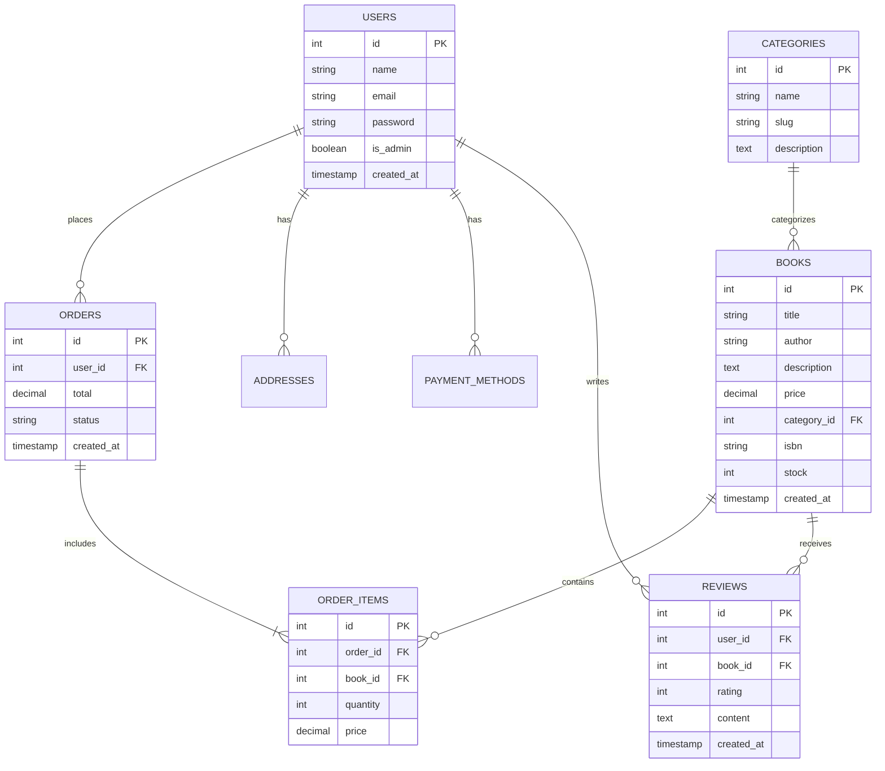

# Database Schema

## Overview

BookHaven uses MySQL for data storage. This document details the database schema, relationships, and key considerations.

## Entity Relationship Diagram

## Tables

### users
