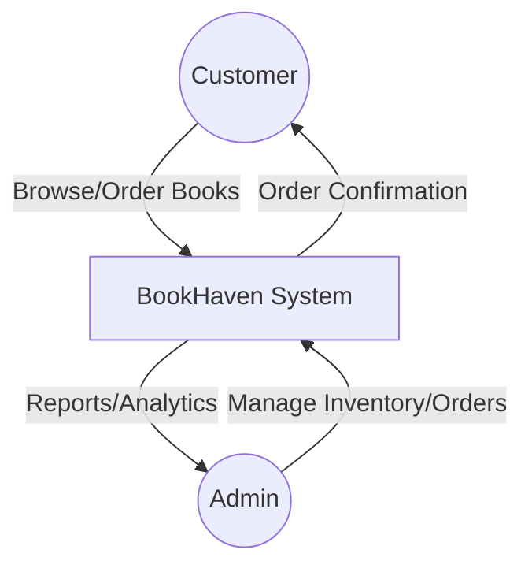

# Data Flow Diagrams

## Context Level (Level 0)



## Level 1: Main System Processes

```mermaid
graph TD
    subgraph Customer Processes
        BP[Book Processing]
        OP[Order Processing]
        UP[User Processing]
    end
  
    subgraph Data Stores
        Books[(Books DB)]
        Orders[(Orders DB)]
        Users[(Users DB)]
    end
  
    Customer((Customer)) -->|Search/Browse| BP
    BP -->|Book Data| Customer
    Customer -->|Place Order| OP
    OP -->|Order Status| Customer
    Customer -->|Register/Login| UP
    UP -->|User Data| Customer
