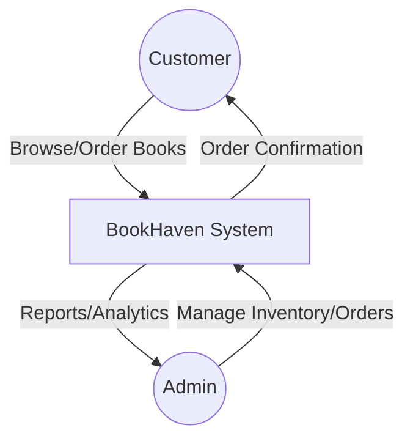
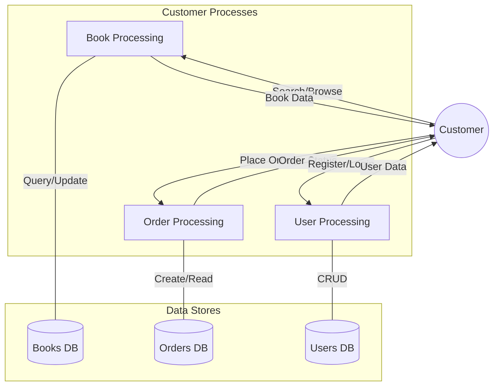

# Data Flow Diagrams

## Context Level (Level 0)



## Level 1: Main System Processes



## Level 2: Book Management Flow

```mermaid
graph TD
    Search[Search Books]
    Filter[Filter Books]
    View[View Details]
    Cart[Shopping Cart]
    Books[(Books DB)]
  
    Search -->|Query| Books
    Filter -->|Filter Criteria| Books
    Books -->|Book Data| View
